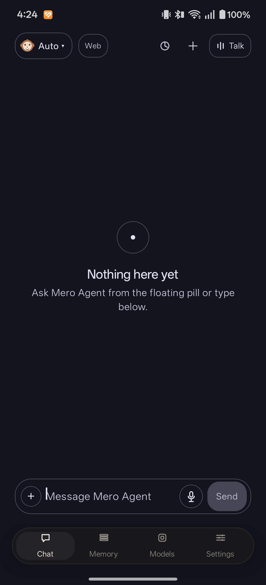
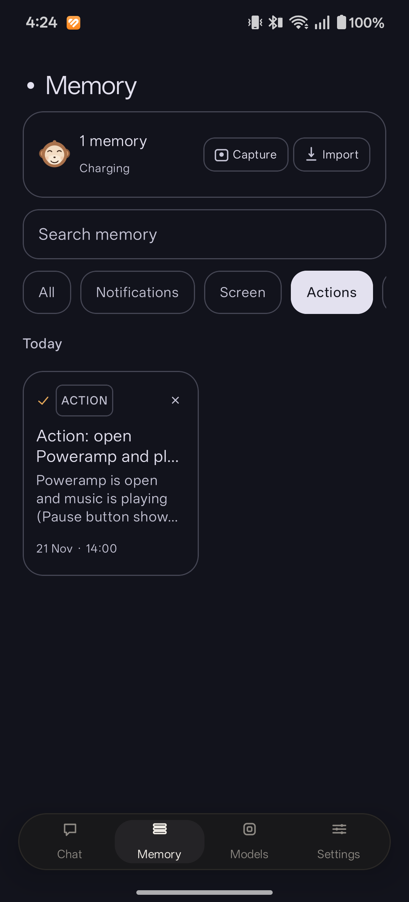
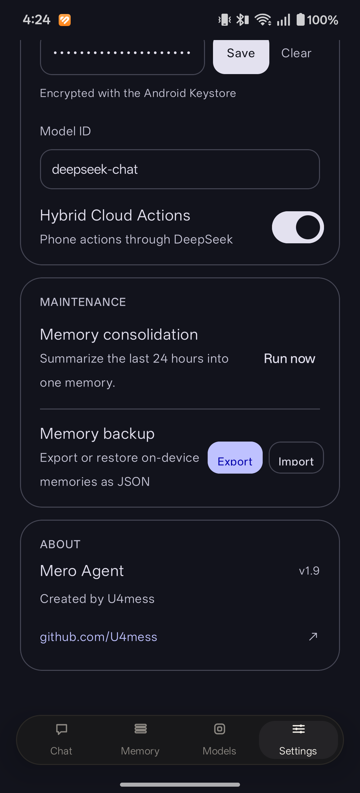
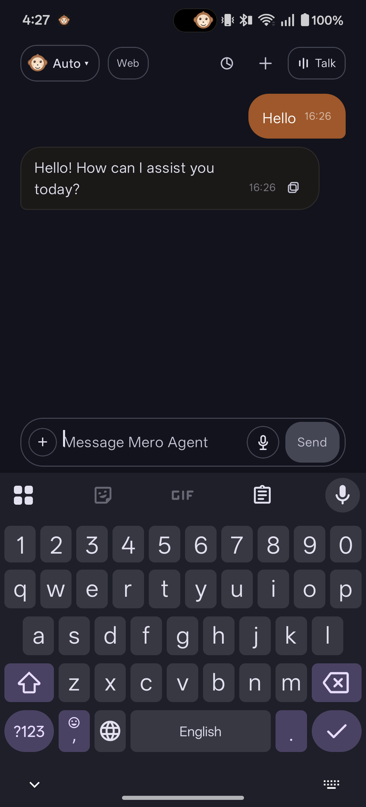

# Mero Agent

[](https://github.com/U4mess/Mero-Agent/actions/workflows/build-apk.yml)

**Mero Agent** is a local-first, privacy-focused Android AI assistant powered by `llama.cpp` (GGUF) and on-device ObjectBox RAG.

## Screenshots

<p align="center">
  
  
  
  
</p>

---

## Features

- **On-Device LLM Inference:** Run local GGUF chat and embedding models (`arm64-v8a`) directly on your phone via `llama.cpp` with zero cloud dependency.
- **ObjectBox Memory & RAG:** Automatically indexes screenshots (ML Kit OCR), PDFs (PDFBox), and notifications into a local vector store with semantic search and memory consolidation.
- **Hybrid Routing (`Auto` / `Local` / `Cloud` + `Web`):** Switch seamlessly between local inference, optional cloud providers (DeepSeek, OpenRouter, OpenAI), and live web search (Brave Search API with DuckDuckGo fallback).
- **Dynamic Island & Voice:** Customizable floating status pill (X/Y offset and width sliders), voice input, and TTS replies.
- **Memory Backup & Restore:** One-tap versioned JSON export/import via Android SAF with automatic deduplication and embedding preservation.
- **Hybrid M3 UI:** Pure OLED Black, Dark, Light, System, and Dynamic themes with multi-chat threading, Markdown rendering, Android Share Sheet support, and an auto-hiding dock.

---

## Security & Privacy

- **Keystore-Backed Secrets:** All API keys are encrypted with AES/GCM via the Android Keystore—never stored in plaintext.
- **HTTPS-Only Networking:** Enforced at the OS level via `network_security_config.xml` (`cleartextTrafficPermitted="false"`).
- **Hardened Manifest:** `android:allowBackup="false"`, strict `android:exported` rules, and `BuildConfig.DEBUG`-gated logging.
- **R8 Release Hardening:** `isMinifyEnabled = true`, `isShrinkResources = true`, and `isDebuggable = false` in release builds.

---

## Tech Stack

- **Language & UI:** Kotlin, Jetpack Compose (Material 3)
- **Local AI:** `llama.cpp` (JNI / NDK `27.2.12479018` / CMake `3.22.1`)
- **Vector DB:** ObjectBox
- **Document & Vision:** Google ML Kit OCR, Apache PDFBox

---

## Building from Source

### Prerequisites
- JDK 17
- Android SDK (Compile SDK 36, Target SDK 35, Min SDK 29)
- Android NDK `27.2.12479018` & CMake `3.22.1`

### Clone & Build
```bash
git clone --recursive [https://github.com/U4mess/Mero-Agent.git](https://github.com/U4mess/Mero-Agent.git)
cd Mero-Agent
./gradlew assembleRelease
```

The release APK is generated at:
```text
app/build/outputs/apk/release/app-release.apk
```

### Release Signing (Optional)
Create a gitignored `keystore.properties` in the project root (or set GitHub Actions secrets):
```properties
KEYSTORE_FILE=release.jks
KEYSTORE_PASSWORD=your_store_password
KEY_ALIAS=your_key_alias
KEY_PASSWORD=your_key_password
```
When omitted, Gradle falls back to debug signing for local testing.

---

## Credits

Created by **[U4mess](https://github.com/U4mess)**.
